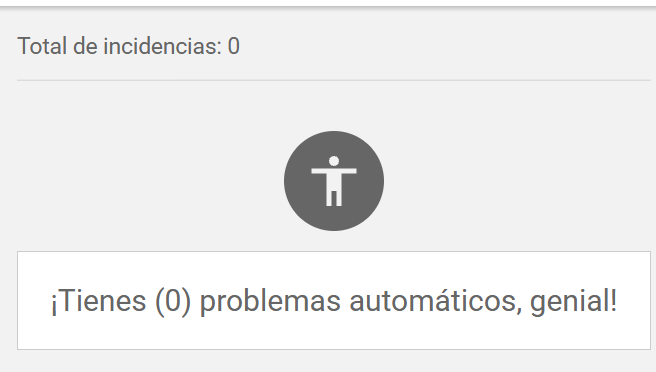

# Tarea 3

Pruebas de accesibilidad en la página de Sibo Body Care

# Índice de bugs

## Agregar productos

- [bug-001](agregar-productos/bugs/bug-001.md)
- [bug-002](agregar-productos/bugs/bug-002.md)
- [bug-003](agregar-productos/bugs/bug-003.md)

## Buscar productos

- [bug-004](buscar-productos/bugs/bug-004.md)
- [bug-005](buscar-productos/bugs/bug-005.md)
- [bug-006](buscar-productos/bugs/bug-006.md)
- [bug-007](buscar-productos/bugs/bug-007.md)

## Información de usuario

- [bug-008](info-usuario/bug-008.md)
- [bug-009](info-usuario/bug-009.md)

# Aclaraciones

## Sobre los bugs en la página de checkout

La herramienta AxeDevTools no encontró ningún bug de accesibilidad en la página de checkout.

## Sobre los bugs en la página de Mi cuenta

La mayoría de los bugs de esta página son de funcionalidad y no de accesibilidad. Esta página contiene muy pocos elementos en general, por lo que los problemas de accesibilidad son mínimos.