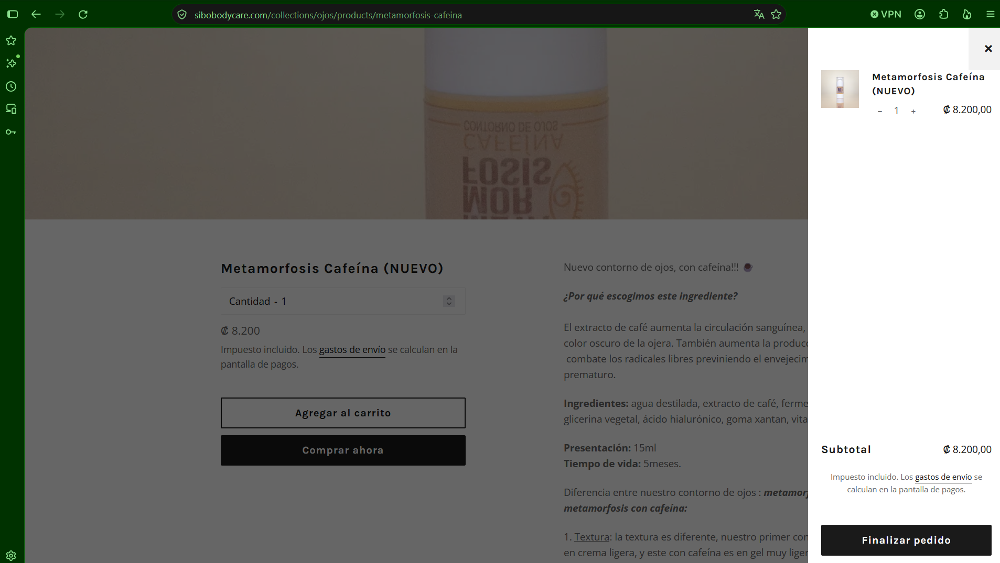

# Mejora 1

## Área

Agregar productos

## Elemento

Controles de cantidad

## Descripción del problema

Los símbolos “−” y “+” son pequeños y tienen poca diferenciación visual. Esto puede dificultar que el usuario los identifique como controles y los utilice, especialmente en pantallas táctiles.

## Objetivo

Facilitar la modificación de cantidades y dar claridad sobre el resultado de cada acción.

## Descripción de la mejora

Presentar la cantidad junto a botones claramente identificables para aumentarla o disminuirla. Cada cambio exitoso debe reflejarse en el carrito y en el subtotal. Si el cambio falla, informar al usuario y conservar la última cantidad confirmada.

## Elementos nuevos

| Elemento | Comportamiento propuesto |
|---|---|
| **Etiqueta “Cantidad”** | Identificar claramente el valor que se está modificando. |
| **Botones para disminuir y aumentar** | Usar controles con áreas de interacción amplias y foco visible. |
| **Actualización del carrito** | Reflejar la cantidad y el subtotal después de un cambio exitoso. |
| **Estado de error** | Informar si no se pudo actualizar y mantener la última cantidad confirmada. |

## Criterios de aceptación

1. La etiqueta “Cantidad” y el valor están agrupados visualmente para que se entienda qué se está ajustando.
2. Los botones para disminuir y aumentar se distinguen claramente entre sí y del valor de cantidad.
3. Los botones tienen un tamaño y espaciado que facilitan su identificación y uso en pantallas táctiles.
4. Los controles muestran estados visuales perceptibles al pasar el mouse, recibir foco y estar deshabilitados, con foco visible al navegar con teclado.
5. La etiqueta y los botones tienen nombres accesibles que identifican su propósito y el producto correspondiente.
6. La disposición de los controles es legible y fácil de usar en pantallas de escritorio y dispositivos móviles.

## Evidencia

Descripción: El carrito de compras muestra que los botones “+” y “−” son pequeños y se distinguen poco del número que indica la cantidad.