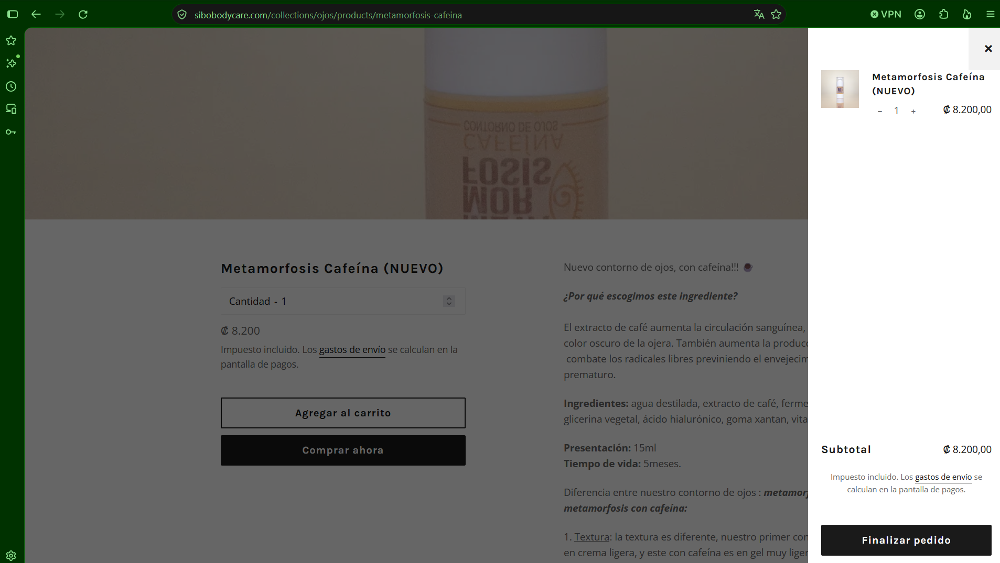

# Mejora 2

## Área

Agregar productos

## Elemento

Encabezado del carrito

## Descripción del problema

El panel no muestra un encabezado que lo identifique como carrito ni indique cuántas unidades contiene. Esto puede dificultar que el usuario entienda rápidamente el contenido del panel.

## Objetivo

Dar contexto inmediato sobre el contenido del panel del carrito.

## Descripción de la mejora

Añadir en la parte superior del panel un encabezado “Tu carrito” con un contador del total de unidades. El texto y el contador deben actualizarse cuando cambie el contenido y adaptarse al espacio disponible en móvil.

## Elementos nuevos

| Elemento | Comportamiento propuesto |
|---|---|
| **Título “Tu carrito”** | Identificar claramente el panel. |
| **Contador de unidades** | Mostrar la suma de las unidades agregadas, con texto en singular o plural según corresponda. |
| **Estado de carrito vacío** | Reflejar claramente cuando no haya productos en el carrito. |
| **Encabezado adaptable** | Mantener el título y el contador legibles en escritorio y móvil. |

## Criterios de aceptación

1. El título y el contador son visibles al abrir el panel.
2. El contador refleja la suma de unidades y se actualiza al cambiar el contenido del carrito.
3. El texto se adapta correctamente a singular, plural y carrito vacío.
4. El encabezado permanece legible en escritorio y móvil.

## Evidencia

Descripción: El panel del carrito no muestra el encabezado “Tu carrito” ni incluye un contador de unidades.
