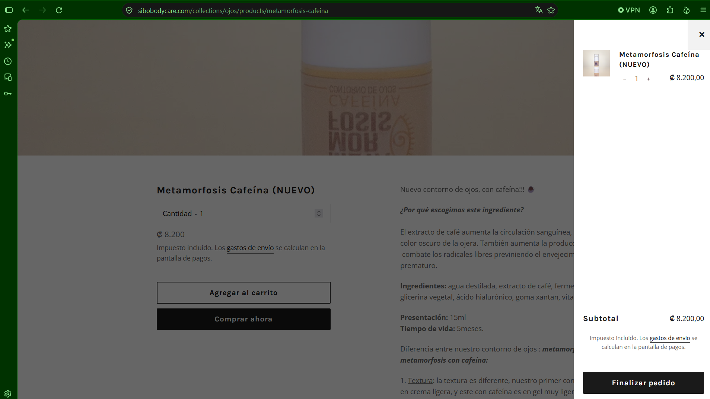

# Mejora 3

## Área

Agregar productos

## Elemento

Acción para seguir comprando

## Descripción del problema

La “X” parece ser la única forma visible de cerrar el carrito. Aunque permite volver a la página, no comunica explícitamente la opción de continuar comprando.

## Objetivo

Ofrecer una forma clara de regresar a la navegación sin perder el contenido del carrito.

## Descripción de la mejora

Añadir dentro del panel una acción secundaria “Seguir comprando”, manteniendo “Finalizar pedido” como acción principal. Al seleccionarla, cerrar el panel, conservar los productos y cantidades, y devolver el foco a un elemento adecuado de la página.

## Elementos nuevos

| Elemento | Comportamiento propuesto |
|---|---|
| **Acción “Seguir comprando”** | Cerrar el panel y permitir continuar en la página actual sin perder el contenido del carrito. |
| **Estilo de acción secundaria** | Diferenciar “Seguir comprando” de la acción principal “Finalizar pedido”. |
| **Retorno de foco** | Al cerrar el panel, devolver el foco a un elemento adecuado de la página. |

## Criterios de aceptación

1. La acción es visible y se puede utilizar con mouse, pantallas táctiles y teclado.
2. Al seleccionarla, el panel se cierra y el usuario permanece en la página actual.
3. Los productos y cantidades del carrito se conservan.
4. Al cerrar el panel, el foco vuelve a un elemento adecuado de la página.

## Evidencia

Descripción: El panel del carrito no muestra la acción “Seguir comprando” ni tiene un encabezado.