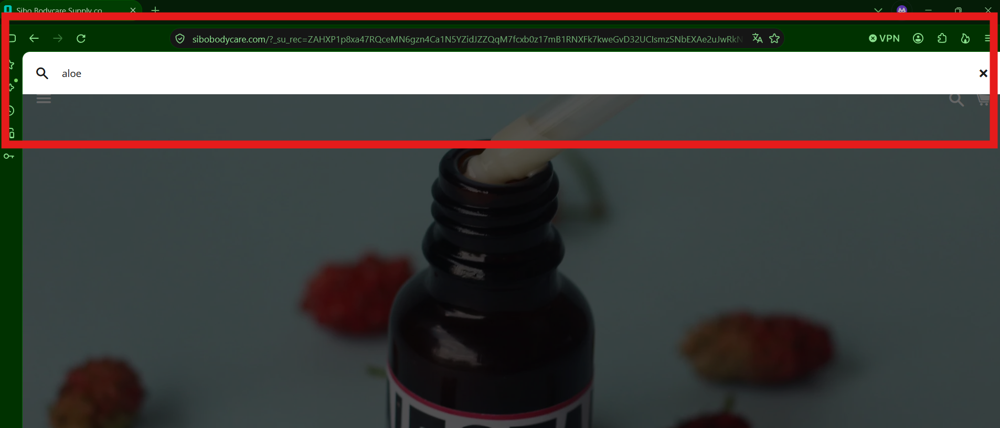

# Mejora 1

## Área

Buscar productos

## Elemento

Barra de búsqueda principal

## Descripción del problema

La barra de búsqueda actual permite introducir texto, pero **no ofrece sugerencias mientras la persona escribe**. Esto exige que el usuario sepa qué buscar y cómo se llama el producto, y dificulta descubrir alternativas cuando no conoce el catálogo.

Solo se cubre el estado inicial de la búsqueda en este análisis.

## Objetivo

Facilitar que las personas encuentren productos relevantes y descubran opciones del catálogo con menos esfuerzo.

## Descripción de la mejora

Incorporar un panel de sugerencias debajo de la barra de búsqueda. A medida que el usuario escriba, el panel mostrará coincidencias relevantes y permitirá acceder directamente a un producto o consultar todos los resultados.

También se propone reemplazar el texto actual por una guía más útil, por ejemplo: **“Busca productos, ingredientes o necesidades de tu piel”**. Esto requiere que la búsqueda pueda encontrar productos por esos términos; de lo contrario, el texto debe ajustarse a las capacidades reales.

- **Interacción y accesibilidad:** La interfaz debe permitir navegar por las sugerencias con el teclado, mantener el foco visible y ser compatible con lectores de pantalla. El panel también debe funcionar en dispositivos móviles.

## Elementos nuevos

| Elemento | Comportamiento propuesto |
|---|---|
| **Sugerencias de productos** | Mostrar nombre, imagen y precio; indicar si el producto está agotado. Al seleccionar uno, abrir su página. |
| **Sugerencias de categorías** | Mostrar categorías relacionadas cuando existan coincidencias, diferenciadas de los productos. |
| **Ver todos los resultados** | Enlace que ejecute la búsqueda y abra la página completa de resultados. La tecla Enter debe permitir lo mismo. |
| **Estado sin coincidencias** | Mostrar un mensaje claro y ofrecer consultar todos los resultados o explorar categorías. |
| **Borrar y cerrar** | Distinguir entre borrar el texto introducido y cerrar el panel de búsqueda. |

## Criterios de aceptación

1. Al escribir una búsqueda con coincidencias, se muestran al menos 2 sugerencias relevantes sin tener que enviar el formulario.
2. Cada producto sugerido muestra nombre, imagen, precio y disponibilidad cuando corresponda, y abre su página al seleccionarlo.
3. El usuario puede ejecutar la búsqueda completa con Enter o mediante “Ver todos los resultados”.
4. Si no hay coincidencias o falla la carga, se muestra el estado correspondiente sin impedir la búsqueda completa.
5. El panel puede utilizarse con teclado y en pantallas móviles.

## Evidencia

Descripción: La imagen muestra la barra de búsqueda principal de la página con el texto de ejemplo “aloe”. No se observa ningún tipo de recomendación o sugerencia mientras se escribe.