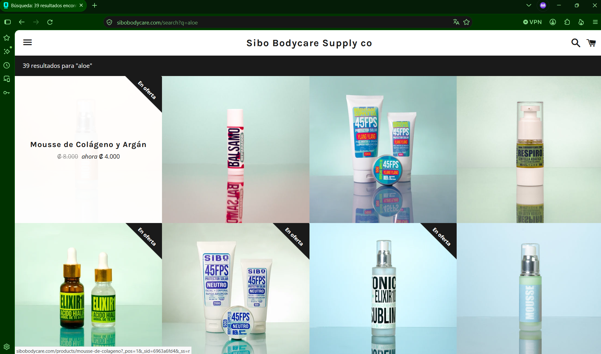

# Mejora 3

## Área

Buscar productos

## Elemento

Tarjetas de producto

## Descripción del problema

La página muestra una cuadrícula de fotografías atractivas, pero el nombre y el precio solo aparecen al pasar el mouse sobre cada producto. Esto obliga a interactuar con las tarjetas una por una para identificar y comparar productos, y dificulta consultar esa información en dispositivos táctiles o mediante teclado.

## Objetivo

Facilitar la identificación y comparación de productos mostrando su información esencial sin requerir interacción con cada tarjeta.

## Descripción de la mejora

Mostrar siempre el nombre y el precio debajo de la imagen de cada producto. La fotografía puede seguir siendo protagonista y se puede conservar un efecto visual al pasar el mouse, siempre que no oculte información ni sea necesario para acceder a ella.

## Elementos nuevos

| Elemento | Comportamiento propuesto |
|---|---|
| **Información visible en cada tarjeta** | Mostrar el nombre y el precio sin depender de efectos al pasar el mouse o tocar la tarjeta. |
| **Información complementaria** | Mostrar la disponibilidad y, cuando corresponda, el precio anterior y una etiqueta de oferta. |
| **Interacción accesible** | Mantener el texto legible y accesible con mouse, pantalla táctil y teclado. |

## Criterios de aceptación

1. El nombre y el precio de cada producto son visibles sin pasar el mouse ni tocar la tarjeta.
2. La disponibilidad se muestra cuando corresponda; si hay un precio anterior o una oferta, ambos se distinguen claramente.
3. La información de las tarjetas es legible en escritorio y dispositivos móviles, y puede consultarse con el teclado. Si la tarjeta es interactiva, debe mostrar un indicador de foco visible.

## Evidencia

Descripción: La imagen muestra los resultados de búsqueda para el término "aloe", con varias tarjetas de productos. El nombre y el precio no son visibles sin pasar el mouse sobre las tarjetas.
