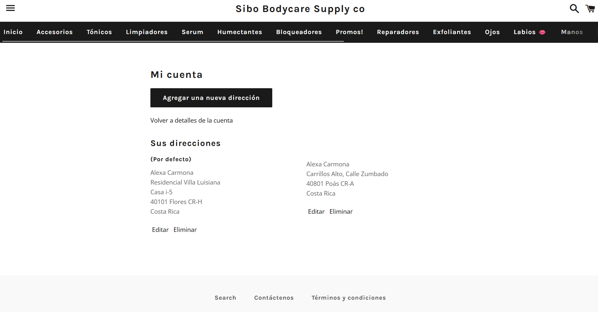

# Mejora 1

## Área

Información del usuario

## Elemento

Presentación de direcciones

## Descripción del problema

Las direcciones aparecen en columnas sin una separación visual clara. Cuando hay varias, puede ser difícil distinguir dónde termina una y empieza la siguiente, así como revisar cada dirección rápidamente.

## Objetivo

Facilitar que las personas identifiquen y diferencien sus direcciones de un vistazo.

## Descripción de la mejora

Presentar cada dirección en una tarjeta o sección claramente delimitada, agrupando en ella la información que le corresponde. Mantener una jerarquía visual consistente y adaptable a pantallas pequeñas.

## Elementos nuevos

| Elemento | Comportamiento propuesto |
|---|---|
| **Tarjeta de dirección** | Agrupar y mostrar claramente la información de una dirección. |
| **Separación visual** | Distinguir cada tarjeta de las demás mediante espaciado y límites visuales consistentes. |
| **Etiqueta de dirección predeterminada** | Identificar la dirección predeterminada dentro de su tarjeta, cuando corresponda. |

## Criterios de aceptación

1. Cada dirección se muestra en una tarjeta o sección visualmente diferenciada de las demás.
2. La información de cada dirección aparece agrupada dentro de su tarjeta.
3. La dirección predeterminada se identifica claramente, cuando exista.
4. La presentación de las direcciones se adapta a pantallas de escritorio y dispositivos móviles, y mantiene el texto legible.

## Evidencia

Descripción: La imagen muestra el estado actual de la página de cuenta del usuario, donde las direcciones se presentan sin una separación visual clara, lo que dificulta identificarlas rápidamente.