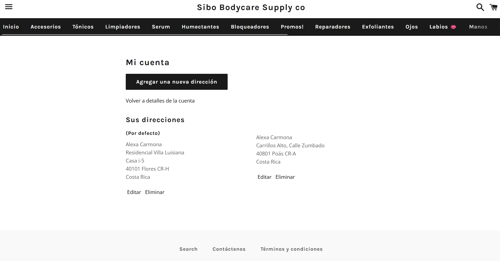

# Mejora 2

## Área

Información del usuario

## Elemento

Acciones de las direcciones

## Descripción del problema

Las acciones para editar o eliminar una dirección pueden no distinguirse con claridad ni indicar a qué dirección corresponden. Al administrar varias direcciones, esto puede causar confusión y aumentar el riesgo de modificar o eliminar la dirección equivocada.

## Objetivo

Hacer que las acciones para editar, eliminar o establecer una dirección predeterminada sean claras y estén asociadas inequívocamente con la dirección correspondiente.

## Descripción de la mejora

Ubicar las acciones dentro de la tarjeta de la dirección a la que pertenecen. Usar etiquetas o controles fáciles de reconocer para editar y eliminar, y conservar una confirmación antes de eliminar.

## Elementos nuevos

| Elemento | Comportamiento propuesto |
|---|---|
| **Acción “Editar”** | Abrir la edición de la dirección de cuya tarjeta forma parte. |
| **Acción “Eliminar”** | Eliminar únicamente la dirección asociada, después de la confirmación existente. |
| **Acción de dirección predeterminada** | Permitir establecer como predeterminada la dirección asociada, cuando corresponda. |
| **Ubicación de acciones** | Mantener las acciones dentro de la tarjeta de su dirección, con etiquetas visibles y comprensibles. |

## Criterios de aceptación

1. Las acciones de edición y eliminación están claramente identificadas y agrupadas con su dirección.
2. Al seleccionar “Editar”, se abre la dirección correcta.
3. Al seleccionar “Eliminar”, se identifica la dirección que se eliminará y se solicita confirmación antes de completar la acción.
4. Si se permite cambiar la dirección predeterminada, la acción afecta únicamente a la dirección seleccionada y el cambio queda indicado en la interfaz.
5. Las acciones se pueden utilizar con mouse, teclado y pantallas táctiles, y cuentan con indicadores de foco visibles y controles legibles en escritorio y dispositivos móviles.

## Evidencia

Descripción: La imagen muestra las acciones de edición, eliminación y cambio de dirección predeterminada debajo de la dirección, pero no se percibe claramente que pertenezcan a la tarjeta correspondiente. Los botones se pueden confundir fácilmente con el resto de la información de la dirección.
