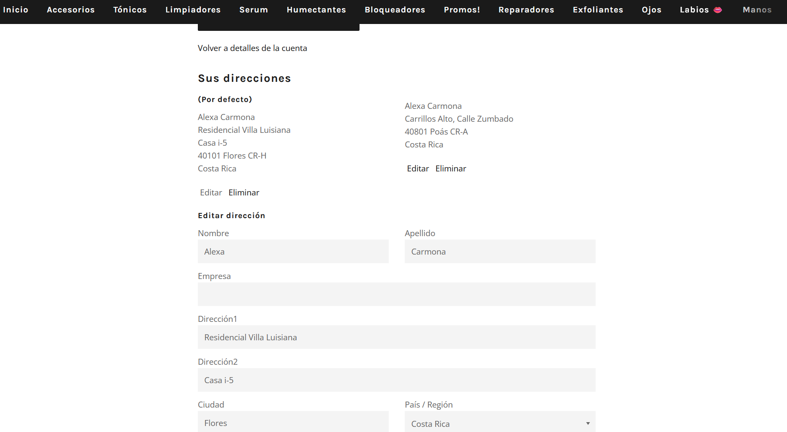

# Mejora 3

## Área

Información del usuario

## Elemento

Datos personales y datos de dirección

## Descripción del problema

El formulario de dirección incluye nombre y apellido, pero no se observa una sección independiente para editar los datos personales. Esto puede generar dudas sobre si esos campos corresponden al destinatario de la dirección o al titular de la cuenta.

## Objetivo

Separar con claridad los datos personales del titular de la cuenta de los datos asociados a cada dirección, para que las personas sepan qué información están consultando o modificando.

## Descripción de la mejora

Crear una sección independiente para los datos personales del usuario, como el nombre, los apellidos, el correo electrónico y el teléfono, siempre que esos campos correspondan al titular de la cuenta. Mantener en el formulario de dirección los datos que identifican al destinatario y la ubicación.

Antes de separar o trasladar campos existentes, confirmar cómo se almacenan y utilizan el nombre y los apellidos: podrían identificar al destinatario, al titular de la cuenta o a ambos. Etiquetar cada campo según su función real y asegurar que editar una sección no cambie accidentalmente los datos de la otra.

## Elementos nuevos

| Elemento | Comportamiento propuesto |
|---|---|
| **Sección de datos personales** | Mostrar y permitir editar los datos que pertenecen al titular de la cuenta, de acuerdo con el modelo de datos existente. |
| **Formulario de dirección** | Mantener separados los datos de la ubicación y los del destinatario de esa dirección. |
| **Etiquetas aclaratorias** | Indicar a quién corresponde cada campo, especialmente nombre y apellido. |
| **Guardado independiente** | Evitar que la edición de los datos personales sobrescriba los datos del destinatario, o viceversa. |

## Criterios de aceptación

1. Los datos personales del titular y los datos de cada dirección se presentan en secciones diferenciadas.
2. Cada campo indica claramente si corresponde al titular de la cuenta o al destinatario de una dirección.
3. La función de nombre y apellido se confirma según el modelo de datos antes de cambiar su ubicación o comportamiento.
4. Guardar cambios en los datos personales no modifica los datos de destinatario de una dirección, y guardar cambios en una dirección no modifica los datos personales del titular.
5. Los formularios permiten identificar y editar la sección correcta con mouse, teclado y pantallas táctiles, y se adaptan a dispositivos móviles.

## Evidencia

Descripción: La imagen muestra que el formulario de direcciones incluye campos de datos personales.